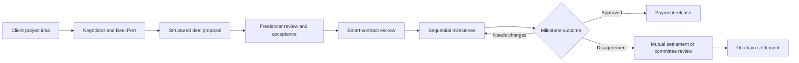

<div align="center">

# SYNQ

### From an idea to an agreement. From work delivered to payment settled.

<p align="center">
  
</p>

**An AI-assisted freelance collaboration platform built around clear agreements, milestone-based smart-contract escrow, and transparent resolution.**

[Explore the platform](#the-synq-experience) · [How protection works](#protection-built-into-the-workflow) · [Technology](#built-with) · [Run locally](#getting-started)

> **Current network:** Ethereum Sepolia testnet · **Status:** Active development and testing

</div>

---

## Work together with more clarity and confidence

Hiring someone online shouldn't mean starting with a blank contract, guessing whether the right freelancer is available, or wondering what happens if a payment or deliverable becomes disputed.

**SYNQ brings the essential parts of freelance collaboration into one connected experience.** Clients can discover talent through **Deal Port**, shape their requirements with **Negotiator**, turn those requirements into structured proposals, and fund work through milestone-based escrow. Freelancers can showcase their skills, review terms before accepting, submit work, and follow the progress of each agreement. If expectations diverge, both sides have a path to negotiate a settlement or escalate a dispute.

AI helps people **prepare and understand agreements**. Smart contracts enforce **the agreed payment rules**. Neither replaces the people making the decisions.

### At a glance

| Discover | Define | Agree | Deliver | Protect |
| --- | --- | --- | --- | --- |
| Find freelancers on Deal Port | Scope projects with Negotiator | Review and sign structured proposals | Track sequential milestones and escrow | Negotiate settlements or seek committee review |

## The SYNQ experience

### 1. Discover freelancers through Deal Port

**Deal Port** is SYNQ's talent discovery space. Clients can browse freelancer profiles, search by relevant skills and categories, review portfolios and starting rates, and check availability before initiating a deal.

Profiles bring together professional details and wallet-linked identity. SYNQ also connects freelancer reputation to completed on-chain deals, helping clients distinguish a profile's claims from its verifiable work history. Eligible clients can leave feedback linked to completed deals.

For freelancers, Deal Port is a place to present their work, skills, services, and availability to prospective clients—not just a wallet address on a contract.

### 2. Turn a rough idea into a real plan with Negotiator

Not every client starts with a perfectly written scope of work. **Negotiator** is SYNQ's conversational deal-building assistant: describe what you want to build, discuss requirements, and progressively shape a draft agreement.

Negotiator can help organize:

- Project titles, scope, and expected deliverables
- Budget, payment asset, and payment structure
- Milestone breakdowns and deadlines
- Counterparty information and missing deal terms
- Questions and considerations to review before committing

A persistent draft view lets users see what's defined and what still needs attention. The conversation can hand confirmed details into the **Create Deal** flow, where the client reviews and edits the actual proposal before signing.

**An important design boundary:** the language model provides guidance; a separate rules-based engine manages and validates the structured draft. Negotiator does **not** sign transactions, deploy contracts, or move escrow funds.

### 3. Find relevant talent from the project itself

When creating a deal, SYNQ can suggest freelancers based on the context of the draft—not just a generic directory search. Its matching logic considers signals such as project title, deliverables, skills, availability, budget context, and verified completion history.

Clients can compare suggested profiles and select a freelancer to continue building the proposal. The displayed match score is a **ranking aid**, not a guarantee of quality, availability, or successful delivery. The current implementation uses explainable, rules-based scoring rather than a predictive AI model.

### 4. Build an agreement both sides can review

SYNQ's **Create Deal** flow converts the project plan into structured terms: participants, deliverables, milestone amounts, review periods, and protection choices.

Rather than immediately deploying a contract for every draft, the client signs an **EIP-712 structured proposal**. The freelancer can inspect the terms and decide whether to accept. Acceptance creates a dedicated escrow contract through the SYNQ factory; the client then funds the deal before the milestone workflow proceeds.

This separates **proposing an agreement**, **accepting it**, and **funding the work** into understandable steps.

### 5. Manage the entire lifecycle in My Deals

**My Deals** is the home for ongoing collaboration. It brings together deployed agreements and pending proposals, with views for the client's and freelancer's different roles.

Users can find deals by search, filter by lifecycle status, and open a deal-specific workspace. Inside that workspace, the available information and actions change with the contract's current state and the connected wallet's role—for example, whether funding is needed, work is ready for review, or a milestone has moved into a settlement process.

The result is a workflow that follows the agreement as it evolves, rather than a static list of blockchain addresses.

### 6. Work and get paid milestone by milestone

SYNQ uses **sequential milestone escrow**. Funds are committed to the deal's smart contract, while work progresses through defined stages. A freelancer submits work with a cryptographic evidence reference; the client can review it, approve payment, or request revisions under the contract's rules.

A simple example:

| Stage | Deliverable | Milestone budget |
| --- | --- | ---: |
| 01 | Product design and wireframes | 1,500 USDC |
| 02 | Frontend implementation | 2,500 USDC |
| 03 | Integration and final delivery | 2,000 USDC |

The contract tracks each milestone independently and enforces the sequence. Approving one milestone releases its allocated funds to the freelancer; it does not automatically mark the entire project complete. Deadlines, review windows, revision handling, and applicable expiry rules are part of the agreed workflow.

SYNQ currently supports its escrow flows on **Ethereum Sepolia**, including canonical Sepolia USDC and supported native-ETH deal paths. These are **testnet assets**, not production payments.

## Protection built into the workflow

A deal is more than a promise to pay. SYNQ is designed to give both sides clear options when work proceeds as expected—and when it doesn't.

### Standard Protection — part of the core deal experience

**Standard Protection** refers to the safeguards provided by SYNQ's supported escrow and resolution workflow without purchasing an additional Premium policy.

- **Funded escrow:** agreed funds are held by the deal's smart contract rather than being sent directly to the freelancer in advance.
- **Milestone checkpoints:** payment follows defined submissions, reviews, approvals, and contract rules.
- **Revision and expiry paths:** supported milestones include mechanisms for feedback and time-based outcomes.
- **Settle Together:** either party can propose a mutually agreed allocation of the remaining milestone funds.
- **Formal dispute resolution:** unresolved disagreements can move to committee review, with on-chain execution of the resulting settlement.

These are procedural and contract-level safeguards—not a promise that either party will always receive their preferred outcome.

### Settle Together before escalating

Disagreements don't always require a formal ruling. **Settle Together** lets the client and freelancer propose a split of a disputed milestone's escrowed funds, review counteroffers, and agree to terms through cryptographic signatures.

Multiple proposals can be considered while valid; accepting an agreed settlement allows the contract to execute the allocation on-chain. If negotiations fail, the parties can use the formal dispute path where eligible.

### Formal resolution, with a second look when permitted

SYNQ's resolution workflow uses a **2-of-3 committee signature threshold** rather than leaving a single participant in control of the settlement outcome. The committee reviews the case and evidence, records an initial decision, and supports a time-limited reconsideration and **Final Review** path under the applicable rules.

The platform includes committee workspaces, resolution history, and reconciliation for transactions that succeed on-chain before the application finishes synchronizing. The final financial result is enforced by the smart contract.

### Premium Protection — optional additional recovery

**Premium Protection V1.1** is a separate, opt-in layer for certain eligible client-side losses. It is not a replacement for Standard Protection.

| | Standard Protection | Premium Protection V1.1 |
| --- | --- | --- |
| **Availability** | Core supported deal workflow | Optional purchase for eligible deals |
| **Price** | No separate protection-policy purchase | **2% premium** calculated on eligible pending escrow |
| **Primary mechanism** | Escrow, milestone rules, mutual settlement, dispute review | Separate protection pool and committee-reviewed claims |
| **When it applies** | According to the milestone and dispute rules | Qualifying expired/abandoned milestones finalized through the supported refund path |
| **Possible outcome** | Release, refund, or split of escrowed funds under contract rules | **Up to 20% additional recovery** of the eligible covered milestone amount |
| **Important limit** | No guaranteed preferred settlement | Subject to policy conditions, committee approval, limits, and available pool liquidity |

For a qualifying claim, the client first completes the required on-chain refund path, then submits a protection claim. An authorized protection committee reviews the claim; an approved claim can be disbursed from the pool according to its rules.

**Premium Protection is not insurance, and payment is not guaranteed.** In V1.1, a committee-resolved split is **not** itself a qualifying Premium claim trigger. Premium fees are nonrefundable under the current policy design.

## Stay informed as a deal moves forward

SYNQ includes an **email notification system** for important collaboration events. It supports updates across proposals, funding, milestone submissions, revision requests, payment releases, settlement activity, disputes, committee outcomes, and direct communication.

Notification preferences let users control major categories of deal-related email. Behind the scenes, an event outbox supports deduplication and retry handling so delivery can be processed reliably when configured and operational.

Email delivery depends on the deployment's mail-provider configuration and background processing; notifications should not be treated as a substitute for checking the deal's actual on-chain status.

## Identity, reputation, and wallet-first access

SYNQ connects users through EVM wallets and supports human-readable handles, professional freelancer listings, and deal-linked feedback. Wallet signatures authenticate users and authorize actions without giving SYNQ custody of their private keys.

Wallet discovery and session handling are designed to avoid unsolicited connections, signatures, or network changes. On-chain records provide an additional source of truth for agreement status and settlement transactions.

A Sepolia **ETH ↔ USDC swap interface** is also available as a testnet utility, with quote freshness checks, slippage controls, and gas-reserve safeguards. Live swap execution has not been comprehensively verified across all conditions.

## What comes next: Agent Protection

SYNQ's longer-term direction includes **Agent Protection**: an AI-assisted layer that could evaluate submitted deliverables against agreed milestone criteria, examine supporting evidence, and recommend whether acceptance conditions have been met.

The vision is to make milestone verification more useful for work that can be checked against objective criteria—while keeping permissions, human oversight, and fund-release authorization explicit.

**Agent Protection is a future concept, not a live payment or adjudication feature.** The current Agent Controller is a *Coming Soon* preview. No AI agent currently has authority to autonomously release escrow or settle disputes.

## Built with

| Layer | Technology |
| --- | --- |
| Application | Next.js App Router, React, TypeScript |
| Interface | Tailwind CSS, Radix UI, Lucide, Framer Motion |
| Wallets and chain access | Wagmi, Viem, EVM wallet connectors |
| Smart contracts | Solidity, Hardhat, OpenZeppelin |
| Data | PostgreSQL, Drizzle ORM |
| AI-assisted drafting | LLM integrations with a deterministic draft engine |
| Email | Nodemailer / configurable SMTP transport |
| Deployment | Vercel-compatible Next.js application |
| Current blockchain | Ethereum Sepolia (`11155111`) |

### How the pieces fit together



Application data supports discovery, drafts, proposals, notifications, and user experience. Smart contracts govern escrow, milestone execution, and eligible resolution transactions. AI assists with planning and matching; it does not control the funds.

## Getting started

> These instructions are for development and testnet exploration. Running the application requires your own configured services, RPC access, and environment variables. Do not use production secrets or real-value assets.

**Prerequisites:** Node.js and npm, a PostgreSQL database, an Ethereum Sepolia RPC endpoint, and an EVM wallet configured for Sepolia.

```bash
# Clone the repository
git clone https://github.com/hrk1415/synq.git
cd synq

# Install dependencies
npm install

# Configure the environment using the repository's supported variable names
# and your own development credentials.

# Start the development server
npm run dev
```

The application also defines:

```bash
npm run build      # Create a production build
npm run start      # Start the production server
npm run db:migrate # Apply configured database migrations
```

**Database caution:** Do not run migrations against an existing shared or production database without reviewing the pending migration files and confirming a restorable backup. The repository's complete environment setup and infrastructure prerequisites should be reviewed before attempting a fresh deployment.

### Configuration reference

The source audit identified environment variable names including:

```dotenv
DATABASE_URL=
NEXT_PUBLIC_SEPOLIA_RPC_URL=
JWT_SECRET=
GROQ_API_KEY=
OPENAI_API_KEY=
SMTP_HOST=
SMTP_PORT=
SMTP_USER=
SMTP_PASS=
CRON_SECRET=
ENABLE_OUTBOX_PROCESSOR=
```

This is **not** an exhaustive or drop-in `.env` template. Different features may require additional configuration. Never commit populated environment files or private credentials.

## Sepolia contract reference

The following addresses are reported by the repository's deployment manifests and source configuration. Verify the current deployment configuration before integrating or sending transactions.

| Contract | Sepolia address |
| --- | --- |
| SYNQ Factory V2 | [`0x9b7C5B529A420d015a85fD77040eF63b0e6cbdb0`](https://sepolia.etherscan.io/address/0x9b7C5B529A420d015a85fD77040eF63b0e6cbdb0) |
| Sequential Deal implementation | [`0x7E376b006Db7798165a6b8E6B191E20e791E4419`](https://sepolia.etherscan.io/address/0x7E376b006Db7798165a6b8E6B191E20e791E4419) |
| Primary Resolution Committee | [`0xd60bBCc7c8aCA633A6D158B6f7F7367E36207676`](https://sepolia.etherscan.io/address/0xd60bBCc7c8aCA633A6D158B6f7F7367E36207676) |
| Premium Protection Manager V1.1 | [`0x462D1b8c1047d05FbE61e15809f4E6A26B12ED00`](https://sepolia.etherscan.io/address/0x462D1b8c1047d05FbE61e15809f4E6A26B12ED00) |
| Protection Pool | [`0xA1f4991597869ba11EbD94edED4d69960063cbc2`](https://sepolia.etherscan.io/address/0xA1f4991597869ba11EbD94edED4d69960063cbc2) |
| Protection Committee | [`0x8e77aFf09Dd37EEa35d2931Ac1aA624abBF94e12`](https://sepolia.etherscan.io/address/0x8e77aFf09Dd37EEa35d2931Ac1aA624abBF94e12) |
| Canonical Sepolia USDC | [`0x1c7D4B196Cb0C7B01d743Fbc6116a902379C7238`](https://sepolia.etherscan.io/address/0x1c7D4B196Cb0C7B01d743Fbc6116a902379C7238) |

Additional identity and directory deployments are defined in the repository's contract configuration. The addresses above are **testnet references**, not mainnet endpoints.

## Current status and limitations

SYNQ is an actively developed **Sepolia testnet platform**. Its current codebase includes the deal workflow, Negotiator, Deal Port, proposal acceptance, milestone escrow, resolution committee workflows, Premium Protection V1.1, and notification infrastructure. Several core escrow, settlement, and Premium Protection paths have been manually exercised on Sepolia, but that does **not** constitute a comprehensive security audit or guarantee that every workflow is free of defects.

Some experiences are still experimental or planned. In particular, Agent Controller / Agent Protection are not live autonomous services, and the swap utility has not been comprehensively transaction-tested. Product behavior also depends on wallet compatibility, RPC availability, configured backend services, and testnet liquidity.

**Nothing in this repository constitutes a guarantee of payment, dispute outcome, protection reimbursement, or investment return.** Smart contracts and testnet integrations can fail; review the relevant code and transaction details before interacting.

## The idea behind SYNQ

The best freelance relationships start with a clear understanding of the work—and stay healthy because both people know what happens next.

SYNQ is building toward a simpler path from **finding the right person**, to **defining the right agreement**, to **getting the work done and settling payment transparently**.

**Less uncertainty between agreement and delivery. More room to focus on the work.**

---

<div align="center">

**SYNQ — Build agreements worth working on.**

*Built and evolving on Ethereum Sepolia.*

</div>
